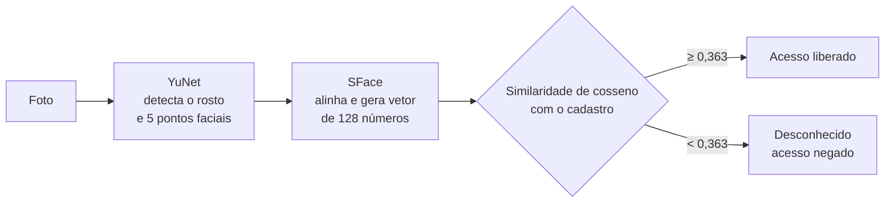
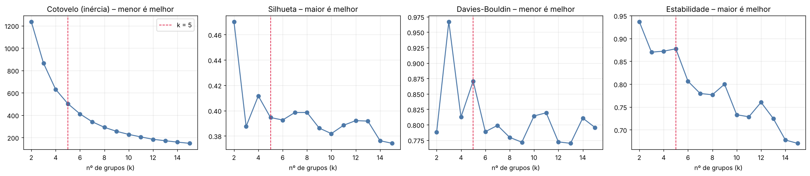
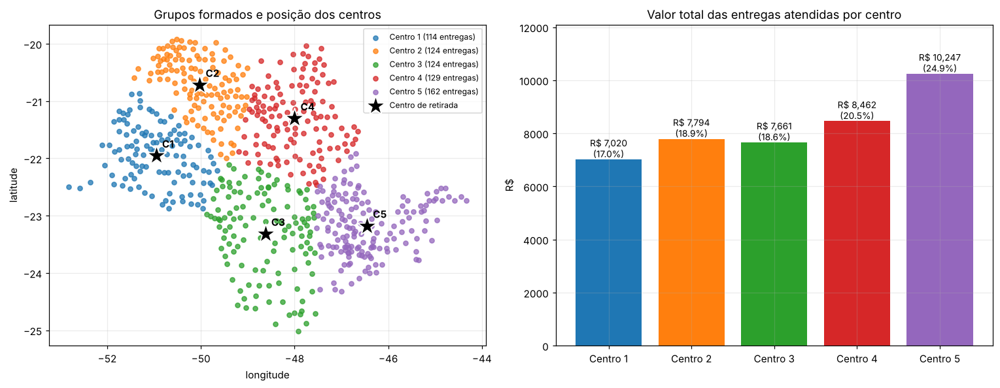

# Melhores Compras: centros de retirada com reconhecimento facial e clusterização

**Duas perguntas de negócio, dois modelos:** o box de retirada pode liberar o cliente sem funcionário? E quantos centros de retirada construir?

Projeto do 2º ano do Tecnólogo em Data Science da FIAP (PBL, Fase 6, 2026) para o e-commerce fictício Melhores Compras.

| Atividade | Pergunta | Técnica | Resultado |
| --- | --- | --- | --- |
| [01 · Reconhecimento facial](01-reconhecimento-facial/) | O box consegue reconhecer o cliente sozinho? | Deep learning pré-treinado (YuNet + SFace), similaridade de cosseno | **100%** de acerto (25 de 25 na validação cruzada) |
| [02 · Clusterização](02-clusterizacao-centros/) | Quantos centros construir e quanto cada um atende? | K-Means comparado com Ward, Mistura Gaussiana e DBSCAN | **5 centros**, atendendo de R$ 7,0 mil a R$ 10,2 mil cada |

---

## 01 · Reconhecimento facial no box de retirada

**Objetivo:** provar que o box pode liberar o acesso **sem funcionário**, reconhecendo o rosto do cliente. Cada pessoa tem 5 fotos: 4 de cadastro e 1 de teste, que simula o cliente chegando ao box.

### Como funciona



1. **Detecção:** o **YuNet**, uma CNN leve do OpenCV Model Zoo, acha o rosto e 5 pontos faciais. Para comparação, o notebook também mostra o Haar Cascade. Se o rosto não aparece de primeira, o código tenta de novo com bordas, escala diferente e limiar menor.
2. **Embedding:** o **SFace** alinha o rosto pelos olhos e o transforma num vetor de 128 características.
3. **Cadastro (*few-shot*):** cada pessoa vira um **vetor-protótipo**, a média das suas 4 fotos. Nada é treinado do zero: com 4 fotos por pessoa, isso só daria overfitting.
4. **Decisão:** vence a maior similaridade de cosseno, desde que acima do limiar oficial do SFace (**0,363**). Abaixo disso, o acesso é negado.

### Resultados

- **5 de 5** fotos de teste reconhecidas, e **25 de 25** na validação cruzada *leave-one-out*, em que cada foto é teste uma vez.
- **Margem de segurança grande:** a menor similaridade correta foi **0,68**, e a maior similaridade com uma pessoa errada ficou em **0,26**, abaixo do limiar.
- A distância euclidiana confirma o resultado: todas entre 0,60 e 0,80, abaixo do limiar de 1,128.

**Próximos passos para produção:** prova de vida (*anti-spoofing*) contra foto ou vídeo de outra pessoa, testes com milhares de rostos, consentimento e tratamento de dados biométricos conforme a LGPD.

> 📸 **Fotos:** o repositório inclui as fotos de um dos integrantes, em `01-reconhecimento-facial/imagem/Ruan/`, como exemplo da estrutura. As fotos das outras pessoas do teste (outra integrante e figuras públicas) não são publicadas, e as imagens foram retiradas das saídas do notebook. Para rodar com várias pessoas, acrescente suas próprias fotos, organizadas assim:
> ```
> imagem/<pessoa>/treino/  (4 fotos)
> imagem/<pessoa>/teste/   (1 foto)
> ```

## 02 · Quantos centros de retirada construir?

**Dados:** 653 locais com falha de entrega (latitude, longitude e valor), somando **R$ 41.183,81**. As coordenadas são fictícias.

**Decisões de modelagem:**
- o agrupamento usa **só a posição**. O valor não entra, para não misturar "perto" com "caro", e serve depois para somar quanto cada centro atende;
- o CSV usa vírgula decimal, e o tratamento é feito numa cópia, sem alterar o arquivo original.

### Escolha do número de centros

Testamos k de 2 a 15 com **cotovelo, silhueta, Davies-Bouldin e estabilidade** por *bootstrap*:



- **k = 2** tem a melhor silhueta, mas só divide a região ao meio, e o cliente continuaria longe do box;
- de **k = 3 em diante as métricas empatam**, ou seja, os pontos formam uma nuvem contínua sem número "natural" de grupos;
- escolhemos **k = 5** pelo equilíbrio entre cobertura e grupos de tamanho parecido, com análise de sensibilidade para 4 e 6 centros.

### Escolha do algoritmo

| Algoritmo (k = 5) | Silhueta | Menor e maior grupo |
| --- | --- | --- |
| **K-Means** | **0,40** | **114 a 162** entregas |
| Mistura Gaussiana | 0,36 | 71 a 179 |
| Hierárquico (Ward) | 0,34 | 66 a 240 |

O **K-Means** venceu porque gera um **centroide**, que vira o ponto candidato para o centro de retirada. Ele também teve a melhor silhueta e os grupos mais equilibrados.

### Resultado: 5 centros



| Centro | Entregas | Valor atendido | % do total |
| --- | ---: | ---: | ---: |
| Centro 1 | 114 | R$ 7.020,18 | 17,1% |
| Centro 2 | 124 | R$ 7.794,24 | 18,9% |
| Centro 3 | 124 | R$ 7.660,93 | 18,6% |
| Centro 4 | 129 | R$ 8.461,52 | 20,5% |
| Centro 5 | 162 | R$ 10.246,94 | 24,9% |
| **Total** | **653** | **R$ 41.183,81** | **100%** |

## Como rodar

```bash
pip install numpy pandas matplotlib scikit-learn opencv-python
jupyter notebook
```

- **Clusterização:** abra `02-clusterizacao-centros/clusterizacao_centros_retirada.ipynb`. O CSV já está em `data/` e a semente é fixa, então o resultado se repete.
- **Reconhecimento facial:** os notebooks foram feitos no Google Colab. Coloque suas fotos em `imagem/` (ou um `imagem.zip`) e rode. Os modelos YuNet e SFace são baixados automaticamente do OpenCV Model Zoo.

## Habilidades aplicadas

`Visão computacional` · `OpenCV` · `Deep learning pré-treinado` · `Embeddings faciais` · `Few-shot learning` · `Validação cruzada` · `Clusterização` · `K-Means` · `Hierárquico (Ward)` · `Mistura Gaussiana` · `DBSCAN` · `Silhueta e Davies-Bouldin` · `Estabilidade por bootstrap` · `Python` · `scikit-learn`

## Equipe (Grupo Paladinos)

- Igor Cardoso Soares da Silva
- Murilo Jucá de Carvalho
- Rozana da Malta Martins
- Ruan Duarte Garcia

> A Melhores Compras é uma empresa fictícia, usada como estudo de caso no curso.
